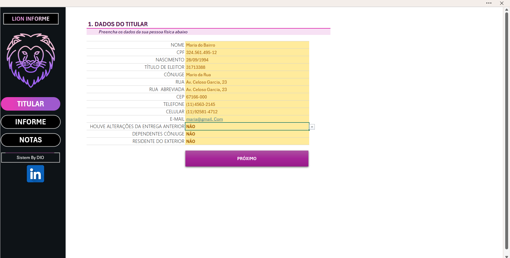
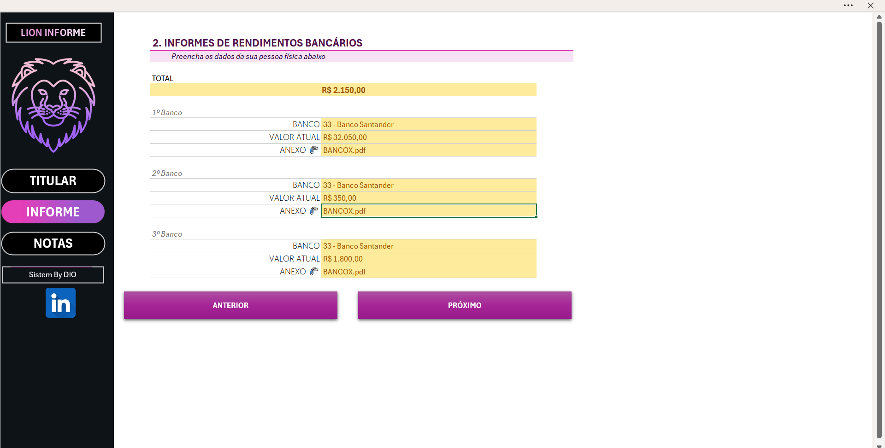
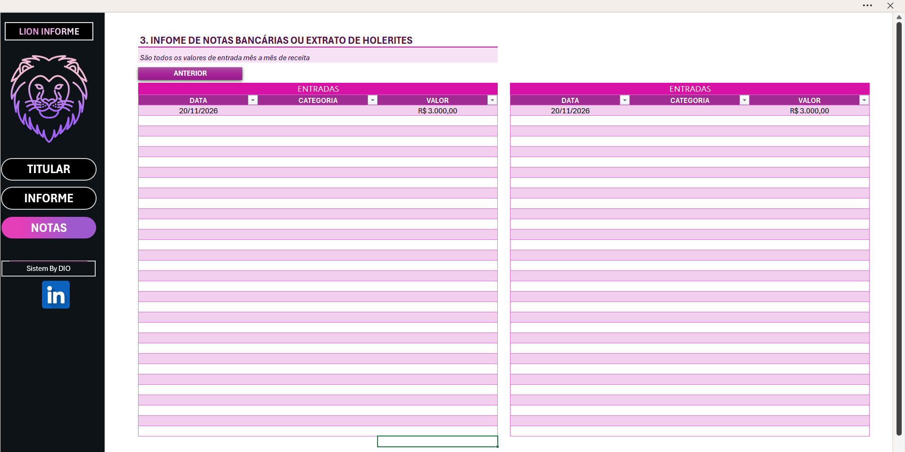

# organizador-de-declara-o-de-imposto-de-renda
Declaração de imposto de Renda: controle e organização das declarações dos contribuintes
# Organizador de Declaração de Imposto de Renda

## 1. Sobre o projeto
Este projeto consiste no desenvolvimento de uma ferramenta em Microsoft Excel para auxiliar na organização e no armazenamento de informações necessárias à preparação da declaração do Imposto de Renda.
A proposta é reunir dados pessoais, informes de rendimentos bancários e registros de entradas financeiras em um único arquivo, facilitando o controle e a consulta das informações pelo usuário.
A ferramenta foi desenvolvida utilizando recursos do Excel, validação de dados, fórmulas e automações com VBA.

## 2. Objetivo
O objetivo é tornar a organização das informações mais prática e eficiente, permitindo que o usuário registre seus dados de maneira estruturada e tenha facilidade para navegar entre as diferentes áreas da planilha.

## 3. Estrutura da ferramenta
A planilha é composta por quatro abas:

### 3.1. TITULAR
Área destinada ao cadastro das informações pessoais do contribuinte, incluindo:
- Nome completo;
- CPF;
- Data de nascimento;
- Título de eleitor;
- Informações do cônjuge;
- Endereço e CEP;
- Telefone e celular;
- E-mail;
- Informações complementares relacionadas à declaração.

Também foram implementados menus suspensos para facilitar o preenchimento de algumas informações.

### 3.2. INFORME
Área destinada ao registro dos informes de rendimentos bancários.
Permite cadastrar informações de até três instituições financeiras, incluindo:
- Instituição bancária;
- Valor atual;
- Identificação do documento de referência (anexo).

A planilha utiliza a função SOMA para calcular automaticamente o total dos valores registrados.

### 3.3. NOTAS
Área destinada ao registro de entradas financeiras e receitas ao longo dos meses.
Permite organizar os lançamentos por:
- Data;
- Categoria;
- Valor.

Foram implementados menus suspensos para selecionar as categorias:
- Holerite;
- CNPJ;
- Freelance.

A aba possui duas áreas de lançamento para facilitar a organização dos registros.

### 3.4. TABELAS
Aba auxiliar que contém uma relação de instituições bancárias utilizadas como base para o preenchimento da ferramenta.
Essa aba permanece oculta para manter a interface principal mais organizada.

## 4. Recursos e funcionalidades utilizados
Durante o desenvolvimento, foram aplicados diferentes recursos do Excel:
- **Validação de dados:** criação de menus suspensos para padronizar o preenchimento das informações.
- **Fórmulas:** utilização da função SOMA para totalizar os valores dos informes bancários.
- **VBA (Visual Basic for Applications):** utilização de macros para automatizar ações e facilitar a navegação entre as abas.
- **Hiperlinks:** acesso rápido ao envio de e-mail por meio do campo de e-mail do titular.
- **Organização de dados:** utilização de uma aba auxiliar para armazenar a relação de instituições bancárias.

## 5. Como utilizar a ferramenta
1. Abra o arquivo no Microsoft Excel e habilite as macros, caso solicitado e após verificar a confiabilidade do arquivo.
2. Acesse a aba TITULAR e preencha as informações pessoais.
3. Na aba INFORME, registre as instituições bancárias, os respectivos valores e a identificação dos documentos.
4. Na aba NOTAS, registre as entradas financeiras, informando data, categoria e valor.
5. Utilize os botões de navegação para alternar entre as abas.
6. Consulte os valores registrados e o total calculado automaticamente na aba INFORME.

## 6. Demonstração da ferramenta
A seguir, serão apresentados registros visuais das principais áreas da ferramenta.

### Cadastro do titular

### Informes de rendimentos bancários

### Registro de entradas financeiras

## 7. Aprendizados adquiridos
O desenvolvimento deste projeto permitiu aplicar conhecimentos de Excel em uma situação prática, explorando recursos de organização de dados, fórmulas, validação de informações e automação com VBA.
Também foi possível compreender a importância de desenvolver ferramentas com uma interface organizada e de fácil utilização, facilitando o acesso às informações e reduzindo dificuldades durante o preenchimento.

## 8. Considerações finais
O Organizador de Declaração de Imposto de Renda foi desenvolvido com o propósito de facilitar a organização das informações financeiras e pessoais utilizadas na preparação da declaração.
A ferramenta funciona como um apoio ao controle de informações, não substituindo o preenchimento e a transmissão da declaração oficial à Receita Federal.

**Observação:** os dados apresentados no arquivo são exemplos demonstrativos e devem ser substituídos pelas informações do usuário antes de qualquer utilização.
